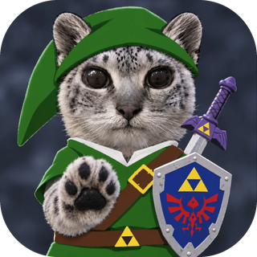

<p align="center">
  
</p>

<h1 align="center">Kid with Sword Remake</h1>

<p align="center">
  <b>The Legend of Zelda: Ocarina of Time (Nintendo Switch 2 Edition) as a native iPhone and Mac app</b><br>
  built on <a href="https://github.com/seedds/nxnative">nxnative</a>
</p>

<p align="center">
  <a href="https://github.com/cheemu21/kid-with-sword-remake/releases"></a>
  
  
  
  <a href="LICENSE"></a>
</p>

<p align="center">
  <a href="https://github.com/cheemu21/kid-with-sword-remake/releases">Releases</a> ·
  <a href="#features">Features</a> ·
  <a href="#requirements">Requirements</a> ·
  <a href="#build">Build</a> ·
  <a href="#install-and-play">Install and play</a> ·
  <a href="#mac-app">Mac app</a> ·
  <a href="#best-settings">Best settings</a> ·
  <a href="#known-issues">Known issues</a> ·
  <a href="#credits">Credits</a>
</p>

> [!NOTE]
> **Not an emulator.** The game's own code runs directly on the Apple chip, with its graphics rebuilt on Metal. Nothing from the game is in this repository or in any release: you build the app yourself from your own copy of the game. Not affiliated with Nintendo.

## Latest: L8.1

L8 is about **smooth, steady play on more iPhones**, a fix for modded characters, and an ocarina microphone you can actually use. Every release is source code only. See [Releases](https://github.com/cheemu21/kid-with-sword-remake/releases) for older builds.

**Mods**

- **Modded Link models no longer go invisible.** A mod's piece of Link that the game set up too early in a session (loading a save within about 20 seconds of starting) was never drawn, which is why the Goku mod vanished on some launches. With a mod on, the game now ignores input for its first 20–25 seconds and shows a **"Getting your mods ready…"** countdown, so a save always loads after that point. With no mod on there is no wait.

**Ocarina microphone**

- **Mic Sensitivity is a 0–100 % slider** (60 % is the old Normal, 90 % the old High).
- **Test Microphone** (All Settings → Controls): live meters for your microphone and for what the game hears, a light when the game would take it as a note, your pitch and the nearest ocarina note, and the slider applied live.

**Smoother play**

- **No CPU stalls from memory the game writes all the time** (nxnative PR #3180): a page the game kept writing could make its threads fault over and over, costing frames and, in Castle Town, stopping them.
- **Saving the shader archive no longer stalls a frame** that needs a new pipeline (upstream).
- **Game data is read ahead in the background** when the game sets it up (L7.7): long pauses at area loads went from 9 to 1 in a test run.
- **Memory is made GPU-ready a little each frame** instead of all at once at an area change (L7.8).

**Memory and stability**

- **Memory pressure mode** (L8.1): when the app nears 4.6 GB, or iOS leaves it less than 3 GB, unused graphics memory is given back sooner, so iOS does not start swapping the game out (the cause of stutter late in a long session).
- **Texture memory is released reliably again** (L8.1): an upstream change made freed texture heaps go only some of the time in this port; it is off by default (`DM_NVN_RES_PLACED_PARENT=1` turns it on).
- Background shader builds and unused thread stacks give their memory back, upload staging no longer waits on residency commits, and more upstream fixes from nxnative.

**Since L6** (the L7 line): the newest nxnative engine, the Texture Memory Saver (under 5 GB on iPhone), texture uploads in 48 MB batches, lighter frame generation, Render Scale down to 0.25 (**Ultra Potato Mode 🥔**), the Mac app, **Mods** (import a .zip or folder, each with a switch and an order; [how](docs/playing.md#mods)), and freeze reports in `log.txt`.

## Features

| Feature | What it does |
|---|---|
| ⚔️ **Native speed** | The game's code runs on the Apple chip; pipelines are built once, then it starts in about 3 seconds |
| 🎞️ **Frame generation** | 30 frames drawn, 60 shown, with MetalFX's frame interpolator |
| 🔍 **MetalFX upscaling** | In place of the game's own upscaler, which cost a phone 5–10 ms a frame |
| 📱 **Wide view** | Fills the iPhone's screen at its own shape, nothing stretched |
| 🎵 **Ocarina with your microphone** | Hum or whistle the notes into your iPhone's or Mac's microphone; a sensitivity slider and a mic tester in the launcher |
| 🛡️ **Amiibo** | From a list, a real figure over NFC, or Shortcuts |
| 🧩 **Mods** | Import romfs mods as a .zip or folder, switch them on and off, set their order; modded Link models always show |
| 🧠 **Texture Memory Saver** | Keeps the app under 5 GB, on by default on iPhone |
| 🥔 **Ultra Potato Mode** | Render Scale down to 0.25 for older phones |
| 💻 **Mac app** | The same launcher, made for the Mac |

In detail:

- **Native speed on iPhone.** The game's code runs on the Apple chip; its shaders are translated ahead of time and its pipelines are built once on the phone, then started in about 3 seconds.
- **Frame generation.** The game draws 30 frames a second and the screen shows 60, with MetalFX's frame interpolator. It never falls back to 30 in play, pauses in the game's menus, and keeps the HUD sharp.
- **60 fps** on an iPhone 18 Pro while the phone is cool.
- **MetalFX upscaling** in place of the game's own upscaler, which cost the phone 5–10 ms a frame.
- **Wide view.** The game fills the iPhone's screen at its own shape, with nothing stretched.
- **A launcher** with the frame limit, frame generation, Wide view, the Ocarina microphone, the Performance HUD and a Render Scale slider on its main screen, and every other setting under All Settings. The iPhone only shows the settings that help a phone.
- **A Mac app** with the same launcher, for Apple silicon Macs.
- **Play the ocarina with your microphone,** on iPhone and Mac. Hum or whistle the notes and the game hears them, like playing the ocarina for real. Turn on **Ocarina Mic** on the launcher's main screen (off by default); the system asks for the microphone once.
- **Amiibo**: pick one from an in-game list, scan a real figure with the iPhone's NFC reader, or tap one through Shortcuts in LiveContainer.
- **Mods** (iPhone): the launcher's Mods button imports a .zip or a folder, finds its `romfs` folder wherever it is, and lists each mod with a switch, an order (the higher one wins a shared file) and swipe to delete. Mods load at Play. 7z and RAR files need unpacking first. See [Mods](docs/playing.md#mods).
- **Touch controls**, and any controller iOS supports.
- **No long freezes when a new shader appears**: a new pipeline gets at most 50 ms of a frame, and is built in the background after that.
- **Steady after area changes**: unused render targets are freed a few at a time, and texture uploads go in batches of at most 48 MB, so memory stays under 5 GB without spikes.
- **Texture Memory Saver**: the finest two detail levels of large textures are left out (All Settings → Performance), on by default on iPhone.
- **Cutscenes in time with their sound** at 30 fps.

## Requirements

- **To build:** an Apple silicon Mac with macOS 26.6 or later, [Xcode](https://developer.apple.com/download/all/?q=Xcode%2027.2) 27.2 with its iOS platform, [Homebrew](https://brew.sh) and Python 3.12 or newer. About 100 GB of free disk for the first build (the game's files, both shader sets and their compile cache).
- **The game:** your own dump of The Legend of Zelda: Ocarina of Time for Nintendo Switch 2, base game plus update v131072.
- **iPhone:** iOS 26 or later. Tested on an **iPhone 18 Pro (12 GB)**. The aim of L7 is the **iPhone 15 Pro and newer**: with the Texture Memory Saver the game stays under 5 GB, which an 8 GB phone can hold, but the 15 Pro and 16 Pro are still untested. On those, start with Render Scale 0.5 or lower.
- **Storage on the phone:** keep at least 15 GB free. The game stops itself under 5 GB free.

## Build

**1. Install the tools** (once), in Terminal:

```
xcodebuild -downloadComponent MetalToolchain
git clone -b L https://github.com/cheemu21/kid-with-sword-remake.git && cd kid-with-sword-remake
brew install xcodegen zstd glslang
python3 -m pip install lz4 "capstone>=5,<6" fonttools nsz zbic "backports.zstd; python_version < '3.14'"
```

The shaders are built with Xcode 27.2's Metal compiler: select it first with `sudo xcode-select -s /Applications/Xcode.app`.

**2. Put your game in a folder**, as a dump (no `prod.keys` needed):

```
~/Games/OcarinaOfTime/
  base/exefs/            main, main.npdm, sdk, rtld
  base/romfs/
  updates/131072/exefs/
  updates/131072/romfs/  the patched RomFS
```

**3. Save the build settings** below as `env.txt`, then **build**:

```
python3 scripts/build_ipa_from_nsp.py ~/Games/OcarinaOfTime --romfs separate --env-file env.txt
```

The app gets the port's icon (`dm/games/0400486024DEC000/icon.png`), as a dump folder has none of its own. To use another picture, add `--icon <image>` (any JPEG or PNG).

The IPA appears in the game's folder. The first build compiles about 43,000 shaders and takes one to two hours; building again reuses them and takes minutes.

### Build settings

Save these lines as `env.txt`:

```
DM_UPSCALER=metalfx
DM_FPS_HOLD=off
DM_THERMAL_CAP=0
DM_QOS_MAP=1
DM_QOS_EDGES=45,59
DM_NVN_GPUPROF=every:600
DM_BOOTPROF=1
DM_GUEST_FILE=1
DM_NVN_TEX_MIP_LEVELS=2
DM_FRAMEGEN_SCALE=0.6
```

## Install and play

1. Install the IPA with LiveContainer (or AltStore, Sideloadly). Turn on **Increased Memory Limit** if your tool offers it.
2. With `--romfs separate`, copy the game files to the phone once with the command the build prints.
3. **First start:** the phone builds its shader cache once, which can take 30–60 minutes. Keep it plugged in on the preparing screen. The second start tidies the cache for a few minutes; after that, starts take about 3 seconds.
4. Your log is `log.txt` in the game's Documents folder: send it with any report.

Controls, saves and settings: [Playing](docs/playing.md).

## Mac app

The same game as a double-clickable Mac app, for Apple silicon Macs. It uses the same game folder and the same launcher as the iPhone: the Render Scale slider, Frame Limit, Frame Generation, Wide view, Ocarina Mic, the Performance HUD and Display Mode (window or full screen) are on its main screen, and every setting is under **All Settings**, including the Mac-only ones.

Build it after step 1 of [Build](#build):

```
python3 scripts/build_ipa_from_nsp.py ~/Games/OcarinaOfTime --platform mac-app --env-file env.txt -o ~/Desktop/"Kid with Sword Remake.app"
```

The Mac build compiles its own shaders and makes the pipelines for your Mac's GPU, so the first build takes a while. It does not need Xcode's iOS platform. On the same disk as the build, the app's game files are APFS clones and take almost no extra space.

- **Your own background picture:** set `DM_LAUNCHER_BG=<image>` (and `DM_LAUNCHER_TITLE=<title>` for the title) when you build, or pick one later under All Settings → **Look** → **Choose a File…**.
- **Keyboard:** Return plays, ⌘, opens All Settings, Esc closes it.
- **Show this window at launch:** turn it off to go straight into the game; hold Option while opening the app to see the launcher again.
- The app is signed ad-hoc, so it opens on the Mac that built it. Copied to another Mac, macOS may block it: allow it under System Settings → Privacy & Security → **Open Anyway**.

## Best settings

| Setting | Value |
|---|---|
| Render Scale | **0.5–0.6** on a Pro iPhone; **0.25 (Ultra Potato Mode 🥔)** if an older phone struggles |
| Frame Limit | **30 with Frame Generation**, or **60** while the phone is cool |
| Texture Memory Saver | **On** (the default on iPhone) |
| Wide view | Your choice: it costs little |
| Performance HUD | Off unless you are measuring |

The iPhone launcher already hides the settings that would make it slower, and uses MetalFX for the game's upscaler. On the Mac, keep **Game's Upscaler** on MetalFX, **Upscaling** on Standard and **Dynamic Resolution** off.

Start with a cool phone: when iOS reports the phone as hot, it halves the CPU's clock and frames drop.

## Known issues

- In heavy areas the iPhone's GPU is near its limit at 30 fps; with frame generation on, some frames drop there.
- Long sessions heat the phone, and iOS lowers its clocks.
- **Being watched:** a member's game froze at a change between areas (L7.4). L8 takes in nxnative's residency fixes in that area; if a freeze happens to you, wait 10 seconds, then send `log.txt`.
- **With a mod on, the first 20–25 seconds ignore input** on purpose (see Latest), so a modded Link always shows.
- Very long sessions that visit many areas can still bring the app near 5 GB; L8.1's memory pressure mode is new, and logs of long sessions help tune it.
- The first area after starting can freeze for up to half a second while its textures load.
- If the picture ever stops for 5 seconds, a watchdog writes the game's threads to `log.txt`: send that log.

## Credits

- **Amiibo and NFC** by **Tizzle2x**.
- **nxnative** by **seedds**, and the current nxnative main these builds start from.
- **ChiefSZ13**: the game's profile and bring-up.
- **vladbondarenko97**: Wide view, first as nxnative PR #1460.
- **Puca**: the movie player's pictures per frame (nxnative PR #2456).
- **AmateurWizrd**: mesh stage memory (nxnative PR #2308).
- **dpadr**: no more write-fault loops on pages the game writes all the time (nxnative PR #3180, in L8).
- **seedds and the nxnative contributors** of the upstream fixes in L8 (PRs #1696, #2714, #2720, #2868, #2870, #3060, #3065).
- **Xipzer**: guest thread wakes (nxnative PR #1466).
- **Pedro Nascimento (lunks)**, **Oliver Ames**, **nanotchec**, **Adrian Smith**, **Romen Adama Caetano Ramírez**, **Travis (travislikestocode)**, **David Lepe**, **uncraftablexd**, **mmkzer0**, **Nimesh Ambepitiya**, **MetaIX**, **TheGoldfish11**, **David Padron-Harris**, **zatteogit**, **tut**, **bettterlabs**, the author of the oot2 branch, and a contributor who signed only as "contributor".

What each made: [docs/games/kid-with-sword-remake.md](https://github.com/cheemu21/kid-with-sword-remake/blob/kid-with-sword-remake/docs/games/kid-with-sword-remake.md#credits).

## Acknowledgements

This project is built on other people's work ([licenses](dm/third_party/README.md)):

- **[nxnative](https://github.com/seedds/nxnative)** (MIT): the engine this port runs on.
- **[d2r-mobile](https://github.com/jhaizhou-ops/d2r-mobile)** (MIT) developed this native-execution approach, for Diablo II: Resurrected; nxnative started from its generic parts.
- **Ryujinx** (MIT): its shader translator turns the game's shaders into SPIR-V, and its emulation of the system is a reference.
- **[Atmosphère](https://github.com/Atmosphere-NX/Atmosphere)**: its kernel, mesosphère, is the reference for Horizon's synchronization.
- **[LibHac](https://github.com/Thealexbarney/LibHac)**: reading game packages.
- **[SPIRV-Cross](https://github.com/KhronosGroup/SPIRV-Cross)** and **[glslang](https://github.com/KhronosGroup/glslang)**: shaders to Metal.
- **[MacNativeGames](https://github.com/ly05010419/MacNativeGames)** (MIT): 8-bit index widening, in-pass clears and the visibility-counter lowering.
- **Apple's [MetalFX](https://developer.apple.com/documentation/metalfx)**: the spatial scaler and the frame interpolator behind frame generation.
- **[Hookshot](https://github.com/NotRexed/Hookshot)** by NotRexed: the idea of frame generation for Ocarina of Time. No code was taken (Hookshot is GPL-3.0).

## License

MIT ([LICENSE](LICENSE)). Third-party code keeps its own license ([dm/third_party](dm/third_party/README.md)).
